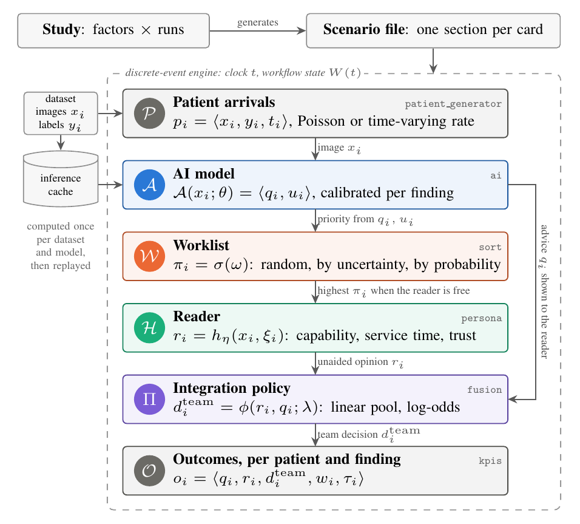
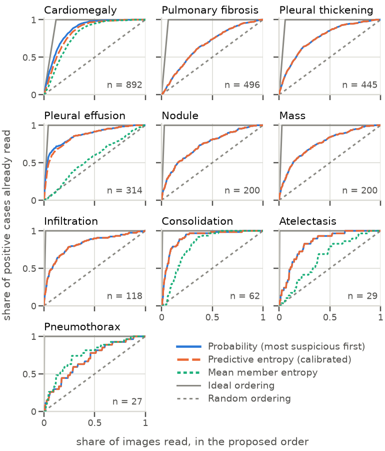
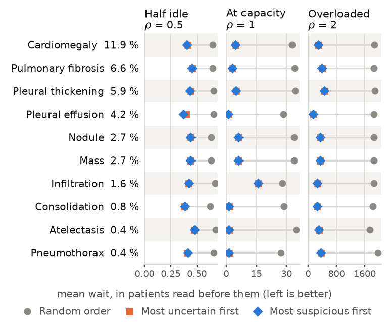
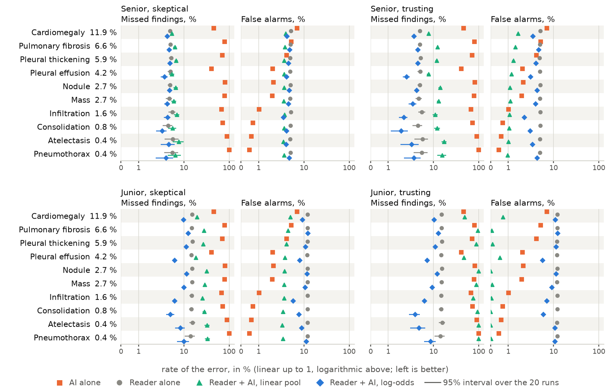

<div align="center">

# HaiSIM

**Simulate a radiology reading room with an AI in it, before running a reader study.**

[](pyproject.toml)
[](LICENSE)
[](https://docs.astral.sh/ruff/)
[](https://mypy-lang.org/)
[](data/README.md)

[Quickstart](#quickstart) ·
[Reproduce the paper](#reproduce-the-paper) ·
[How it works](#how-it-works) ·
[Documentation](docs/README.md)

</div>

AI models for medical imaging are usually judged by image-level metrics such as accuracy
or recall. In a hospital they also change **which patient is read first**, **how long
patients wait**, and **how radiologists combine their own judgement with the AI's
advice**. HaiSIM is a discrete-event simulator for these workflow-level effects. Patients
arrive, an AI reads each chest X-ray, the worklist is reordered, a simulated radiologist
reads the images with or without the AI's advice, and every decision is recorded per
patient and per finding.

<p align="center">
  
</p>

## Highlights

- **Real models, no GPU needed.** The outputs of a DenseNet-121 ensemble, MedGemma 1.5 4B
  and MedGemma 27B on 30,805 NIH ChestX-ray14 and 15,000 VinDr-CXR images ship with the
  repository (21 MB in [`data/cache`](data/README.md)) and are replayed by the simulator.
- **One YAML file per scenario.** Arrivals, AI model, calibration, worklist order, reader
  skill, trust in the AI, the rule that combines the two opinions, and the metrics are all
  configuration lines.
- **Studies, not single runs.** A study crosses factors, repeats each condition with paired
  seeds, compares against a baseline, and writes one tidy CSV.
- **Three verdicts per read.** The AI alone, the reader alone and the reader with the AI
  are recorded on the same read, so the effect of the advice is measured on the same noise.
- **Extensible.** Every component is a Python `Protocol`; a custom metric can live in your
  own file.

## Quickstart

You need Python 3.11 or newer and [uv](https://docs.astral.sh/uv/getting-started/installation/).

```bash
git clone <this repository> hai-sim     # or download the repository and unzip it
cd hai-sim
uv sync
uv run hai-sim run configs/examples/quickstart.yaml
```

In a few seconds, 2,000 NIH ChestX-ray14 patients go through the reading room: MedGemma
27B reads each image, the most suspicious patients go first, and a senior radiologist who
trusts the AI reads them with its advice. The run prints the errors of each actor and the
waiting times:

```
                 KPI - quickstart
+-------------------------------------------------+
| metric          |      ai |   doctor |   hybrid |
|-----------------+---------+----------+----------|
| recall macro    |  0.1678 |   0.9585 |   0.9549 |
| n_FN            |     692 |       33 |       33 |
| n_FP            |     654 |      914 |      835 |
| ...             |         |          |          |
+-------------------------------------------------+
n_patients=2000  wait_doctor=334.07  time_in_sys=347.48
```

`doctor` is the reader alone, `hybrid` the reader with the AI's advice. Open
[`configs/examples/quickstart.yaml`](configs/examples/quickstart.yaml), change the reader
(`persona: junior_skeptical`), the order (`sort.kind: random`) or the integration rule
(`fusion.kind: linear_pool`), and run it again.

## Reproduce the paper

The paper asks four research questions (RQ) with three models on two datasets. All of
them run from the shipped model outputs on a laptop.

**1. Install and build the VinDr-CXR labels.** The VinDr-CXR labels are distributed under
their own terms and do not ship with the repository. The script downloads the annotation
file (about 2 MB) from Kaggle; it needs a [Kaggle API token](https://www.kaggle.com/docs/api)
and the rules of the
[competition](https://www.kaggle.com/competitions/vinbigdata-chest-xray-abnormalities-detection)
accepted once.

```bash
uv sync --extra analysis
uv run python scripts/build_vindr_labels.py
```

**2. Run the two simulation studies, then draw everything.**

| | research question | command | time¹ |
|---|---|---|---|
| RQ3 | Under load, does AI-based ordering shorten the wait of the patients who have a finding? | `uv run hai-sim study configs/studies/queue_load_medgemma27b.yaml --workers 8` | about 5 min |
| RQ4 | Does the AI's advice reduce a reader's errors, and does the integration rule matter? | `uv run hai-sim study configs/studies/team_effect_medgemma27b.yaml --workers 8` | about 5 min |
| RQ1, RQ2 and all figures | Does the AI's order put positive cases, or the model's own misses, first? | `uv run python scripts/paper_figures.py` | about 1 min |

¹ With 8 worker processes on a laptop; `--workers` sets how many.

`paper_figures.py` reruns the capture study of RQ1 and RQ2
([`configs/studies/capture.yaml`](configs/studies/capture.yaml)), reads the newest RQ3 and
RQ4 tables in `out/`, writes the figures of the paper to `out/paper/`, and prints the
table rows, the statistical tests and every number quoted in the text.

<table>
  <tr>
    <td width="33%"></td>
    <td width="33%"></td>
    <td width="33%"></td>
  </tr>
  <tr>
    <td align="center"><sub><b>RQ1</b> positive cases met along the AI's order</sub></td>
    <td align="center"><sub><b>RQ3</b> waiting time under three loads</sub></td>
    <td align="center"><sub><b>RQ4</b> errors of the AI, the reader and the team</sub></td>
  </tr>
</table>

## How it works

A **scenario** describes one reading room; the engine (built on
[SimPy](https://simpy.readthedocs.io/)) runs it on a simulated clock:

| component | what it does | scenario section | options |
|---|---|---|---|
| Patient arrivals | draws patients from a dataset or a cache, at a constant or time-varying rate | `patient_generator` | Poisson, time-varying Poisson (24×7 rates), fixed gaps |
| AI model | gives a probability and an uncertainty per finding | `ai` | cached outputs (shipped), live TorchXRayVision ensemble, MedGemma via vLLM or Transformers, a synthetic AI of chosen skill |
| Calibration | makes the probabilities mean what they say | `ai.calibration` | temperature, Platt scaling per finding, isotonic |
| Worklist | decides who is read next | `sort` | random, most uncertain first, most suspicious first |
| Reader | reads each case, with its own skill, speed and trust | `persona` | six built-in profiles (senior or junior; alone, skeptical or trusting), or your own |
| Integration policy | combines the reader's opinion with the AI's advice | `fusion` | linear pool, log-odds fusion, confidence gate |
| Outcomes | per patient and per finding | `kpis` | errors per actor, team metrics, waits, queue state; custom metrics |

A **study** varies some of these lines over a grid and repeats each condition:

```yaml
# configs/studies/team_effect_medgemma27b.yaml (excerpt)
factors:
  fusion.kind: [linear_pool, log_odds_fusion]
  persona: [senior_skeptical, senior_trusting, junior_skeptical, junior_trusting]
replications: [1, 2, 3, 4, 5, 6, 7, 8, 9, 10, 11, 12, 13, 14, 15, 16, 17, 18, 19, 20]
kpis: [actors, team]
by:
  - key: label      # one row per finding
```

The AI's outputs are computed once per model and dataset and stored in an
**inference cache**, so a study over thousands of real images runs in minutes on a CPU.
The configurations that built the shipped caches are in [`configs/cache/`](configs/cache/).

## Models and data

| model | weights | shipped outputs |
|---|---|---|
| DenseNet-121 ensemble | four [TorchXRayVision](https://github.com/mlmed/torchxrayvision) weight sets: CheXpert, MIMIC-CXR, PadChest, RSNA | `data/cache/*__{chex,mimic_ch,pc,rsna}`, `composed/*__ens4` |
| MedGemma 1.5 4B | [`google/medgemma-1.5-4b-it`](https://huggingface.co/google/medgemma-1.5-4b-it), BF16 | `data/cache/*__medgemma-1.5-4b` |
| MedGemma 27B | [`google/medgemma-27b-it`](https://huggingface.co/google/medgemma-27b-it), FP8 | `data/cache/*__medgemma-27b` |

| dataset | images | labels |
|---|---|---|
| [NIH ChestX-ray14](https://www.kaggle.com/datasets/nih-chest-xrays/data) | 30,805 (one per patient, PA and AP) | inside the cache |
| [VinDr-CXR](https://www.kaggle.com/datasets/awsaf49/vinbigdata-1024-image-dataset) | 15,000 (training set) | built locally by `scripts/build_vindr_labels.py` |

The studies never open an image. To rebuild a cache from the images, see
[`data/README.md`](data/README.md) and the configurations in `configs/cache/`.

## Documentation

| page | content |
|---|---|
| [Usage](docs/usage.md) | installation options, the `hai-sim` commands, seeds and reproducibility |
| [Scenarios](docs/scenarios.md) | every section and field of a scenario file, with recipes |
| [Studies](docs/studies.md) | factor grids, replications, paired contrasts, output tables |
| [Outputs and metrics](docs/outputs.md) | the per-patient record and every metric |
| [Calibration and fusion](docs/calibration-and-fusion.md) | how the AI's advice is calibrated and combined with the reader |
| [Architecture](docs/architecture.md) | the protocols, the module map, how to extend HaiSIM |
| [Glossary](docs/glossary.md) | every acronym and term |
| [Data](data/README.md) | the shipped caches, the labels, the images |

## Development

```bash
uv sync --extra dev --extra analysis
uv run pytest -q          # about 450 tests
uv run ruff check src tests scripts configs
uv run mypy src           # strict
```

Contributions are welcome: see [CONTRIBUTING.md](CONTRIBUTING.md).

## Citation

The paper that presents HaiSIM is under double-blind review. The citation will be added
here after the review.

## License

The code is released under the [MIT License](LICENSE). The datasets and model weights keep
their own terms: NIH ChestX-ray14 (NIH Clinical Center), VinDr-CXR (its authors, through
Kaggle and PhysioNet), TorchXRayVision (Apache 2.0), MedGemma (Health AI Developer
Foundations terms of use).
